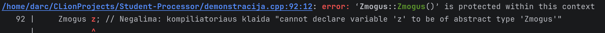
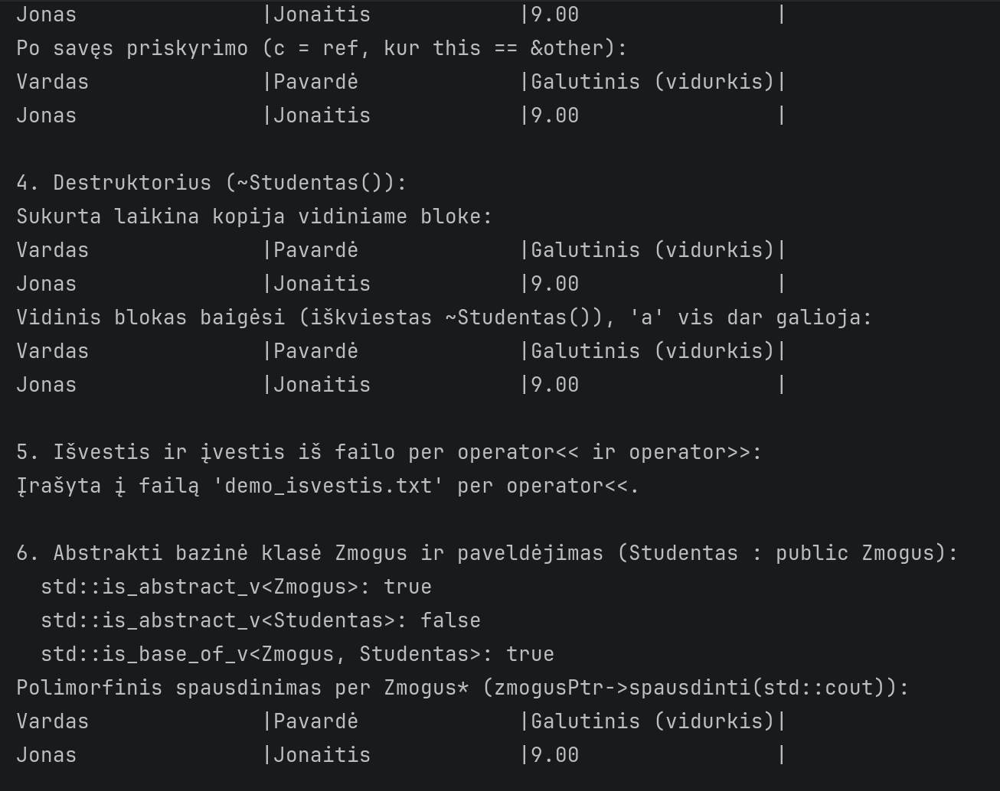

# Student-Processor
## Introduction
This program was written as a project for an Object Oriented Programming course. The purpose of the program is to read or generate student data which will then be used to calculate their final grades.

## Build
The project uses CMake (3.16 or newer) and requires a C++17 compiler.
```bash
cmake -B build -DCMAKE_BUILD_TYPE=Release
cmake --build build
```
When using a multi-config generator (e.g. Visual Studio), build with:
```bash
cmake --build build --config Release
```
The program reads and writes data files in its working directory, so run it from the folder where you want the generated files to be stored.

## Usage
Upon running the compiled program, the user will be prompted with several options to decide the behavior of the program.


The following formula is used for final grade calculation:
```math
Final grade = 0.4 \cdot average\space or\space median + 0.6 \cdot exam
```

## Structure
The project is built using object-oriented principles, splitting person and student logic into an abstract base class (`class Zmogus`) and a derived class (`class Studentas`). The program standardizes on `std::vector<Studentas>` as its primary container and utilizes modern C++ algorithms for optimal partitioning and sorting.

### main.cpp
The program's entry point. It asks the user to choose a mode (manual entry, random generation, reading from a file, benchmark, or Rule of Three & inheritance demonstration), a sort field and order, an output target, which statistic to display (and which statistic to sort by when displaying both). It then dispatches to the corresponding processing functions.

### zmogus.h
- `class Zmogus`: abstract base class representing a person, holding `protected` first and last name members (`vardas_`, `pavarde_`), `protected` constructors/copy/move operations (preventing object slicing), `public` `virtual ~Zmogus()`, inline `const noexcept` getters (`vardas()`, `pavarde()`), and the pure virtual method `virtual void spausdinti(std::ostream& out) const = 0`.
- Because `spausdinti()` is pure virtual, `Zmogus` cannot be instantiated directly (`std::is_abstract_v<Zmogus> == true`), only through derived classes such as `Studentas`.

### studentas.h / studentas.cpp
- `class Studentas : public Zmogus`: derived from `Zmogus`, inheriting `vardas_`, `pavarde_`, `vardas()`, and `pavarde()`, and encapsulating homework grades (`paz_`), exam grade (`exam_`), final grades (`galutinisVid_`, `galutinisMed_`), and input validity (`valid_`) as private member variables.
- Constructors, Destructor & Rule of Five:
  - Default constructor, stream-reading constructor (`skaitytiFaila()`), and interactive/random input constructor (`ivestiRanka()`).
  - Explicit copy constructor (`Studentas(const Studentas&)` calling `: Zmogus(other)`) and copy assignment operator (`operator=(const Studentas&)` calling `Zmogus::operator=(other)` with self-assignment guard `this == &other`), `~Studentas() override`, and defaulted move operations (`= default`).
- Overloaded I/O Operators:
  - `friend std::istream& operator>>(std::istream& is, Studentas& st)`: reads a student from `std::cin` interactively (unknown grade count) or parses a non-empty line from any `std::istream` / `std::ifstream` without needing a pre-known homework count.
  - `friend std::ostream& operator<<(std::ostream& out, const Studentas& st)`: writes a formatted student row (using `Statistika::Vidurkis` by default) to `std::cout` or a file stream.
- Member methods:
  - `galutinis()`, `galutinisVid()`, `galutinisMed()`, `valid()`: inline `const noexcept` getters.
  - `skaiciuotiGalutini()`: calculates the final grade (0.4 × homework average/median + 0.6 × exam).
  - `skaitytiFaila()`: reads and parses a student line with a known homework count from an input stream (kept for fast bulk file reading in benchmarks).
  - `rasytiStudenta()`: formats and writes a student's data row to an output stream for the selected statistic.
  - `spausdinti()`: overrides `Zmogus::spausdinti()` to output the student using `rasytiStudenta(out, Statistika::Vidurkis)`.
  - `ivestiRanka()`: handles console input for manual and randomly generated student records.
- `nuskaitytiStudentus()`: reads students from a specified file into a `std::vector<Studentas>`, dynamically determining the homework count from the header.
- `rusiuotiStudentus()`: sorts the student vector by first name, last name, or final grade (average or median) in ascending or descending order using `std::sort` with comparator helpers (`comparePagalVarda`, `comparePagalPavarde`, `comparePagalGalutini`).
- `skirstytiStudentus()`: splits students into failing (*nuskriaustukai*, final grade < 5) and passing (*kietukai*, final grade ≥ 5) groups using `std::partition`, moving failing students into a separate vector via `std::make_move_iterator` and erasing them from the original vector.

### manual.h / manual.cpp
Console interaction and interactive modes:
- `nustatymai()`, `ivestiSk()`, `taipArNe()`, `iSkaiciu()`: menu prompts and validated numeric and boolean input.
- `rankinisIvedimas()`: interactive student entry (using `std::cin >> st` when the homework count is unknown) and random grade generation.
- `nuskaitytiIsFailo()`, `apdorotiIsFailoIFaila()`: read, process, sort, and output students from an existing file to console or another file.
- `rasytiAntraste()`, `rasytiGrupe()`: write formatted result tables to the console or an output file (using `out << st` for `Statistika::Vidurkis`).

### demonstracija.h / demonstracija.cpp
- `demonstracija()`: runs the interactive/stream demonstration mode covering `operator>>`, `operator<<`, the Rule of Three (copy constructor, copy assignment, self-assignment, destructor), file I/O, compile-time/runtime checks that `Zmogus` is abstract (`std::is_abstract_v<Zmogus>`, `std::is_base_of_v<Zmogus, Studentas>`), and polymorphic printing via `std::unique_ptr<Zmogus>`.

### failai.h / failai.cpp
File I/O helpers:
- `generuotiFaila()`: generates a test file with *n* random students using a buffered `std::ostringstream` for fast disk writes.
- `arFailaiEgzistuoja()`: checks whether the benchmark files already exist so they do not need to be regenerated.
- `trintiFaila()`: deletes benchmark files from disk.

### testai.h / testai.cpp
The benchmarking suite:
- `testas()`: times each processing stage (reading, final grade calculation, partitioning, sorting, and writing passing/failing groups to files) for a given file size.
- `testuPaleistuvas()`: repeats `testas()` 5 times per file size (100,000 and 1,000,000 students) and computes the average duration for each step.

### results.h / results.cpp
- `struct Rezultatai`: stores timing metrics for all benchmark stages.
- `spausdintiLentele()`: exports benchmark timing results as formatted Markdown tables.

### nustatymai.h
The `enum class` types defining application configuration: `Rezimas`, `Rusiuoti`, `Tvarka`, `Statistika`, and `Isvedimas`.

### timer.h
A lightweight `Timer` class built on `std::chrono::high_resolution_clock`, providing `reset()` and `elapsed()` in seconds.

### utils.h / utils.cpp
Helpers:
- `vidurkis()`, `mediana()`: compute average and median values for homework grade collections.
- `utf8Plotis()`, `utf8Ilgis()`: calculate column display widths compensating for multi-byte UTF-8 Lithuanian characters.

### kursiokai.txt
A small sample student file for testing the file-reading mode.


## Benchmarking
Upon running the app, users have the option to select a benchmarking mode. During benchmarking, the program tests performance on files with 100,000 and 1,000,000 students. Students are partitioned into failing (*nuskriaustukai*, grade < 5) and passing (*kietukai*, grade ≥ 5) groups.

All stages are timed and repeated 5 times, and the average times are output to the console and saved to `lenteleVector.txt`.

The benchmark compares performance between the `struct` and `class` implementations, as well as the effects of compiler optimization levels (`-O1`, `-O2`, `-O3`).

## Benchmark Results

### Struct vs Class Comparison

| Implementation | Student count | Average file read time | Average final grade calculation time | Average sorting time | Average grouping time | Average failed student output time | Average passing student output time | Average processing time |
|---|---|---|---|---|---|---|---|---|
| **Struct** | 100,000 | 0.164s | 0.001s | 0.027s | 0.002s | 0.022s | 0.023s | 0.240s |
| **Class** | 100,000 | 0.164s | 0.001s | 0.028s | 0.003s | 0.024s | 0.024s | 0.244s |
| **Struct** | 1,000,000 | 1.620s | 0.011s | 0.268s | 0.023s | 0.279s | 0.283s | 2.484s |
| **Class** | 1,000,000 | 1.668s | 0.011s | 0.281s | 0.032s | 0.290s | 0.292s | 2.574s |

### Compiler Optimization Comparison (-O1, -O2, -O3)

#### Struct vs Class Optimization Comparison (Speed & Executable Size)

| Implementation | Optimization Flag | Executable Size | Processing Time (100,000) | Processing Time (1,000,000) |
|---|---|---|---|---|
| **Struct** | -O1 | 165.0 KiB | 0.236s | 2.581s |
| **Struct** | -O2 | 158.0 KiB | 0.234s | 2.533s |
| **Struct** | -O3 | 184.0 KiB | 0.240s | 2.484s |
| **Class** | -O1 | 115.2 KiB | 0.239s | 2.622s |
| **Class** | -O2 | 117.0 KiB | 0.260s | 2.542s |
| **Class** | -O3 | 139.6 KiB | 0.244s | 2.574s |

##### -O1 (Executable size: 115.2 KiB)

| Student count | Average file read time | Average final grade calculation time | Average sorting time | Average grouping time | Average failed student output time | Average passing student output time | Average processing time |
|---|---|---|---|---|---|---|---|
| 100,000 | 0.163s | 0.002s | 0.027s | 0.003s | 0.022s | 0.023s | 0.239s |
| 1,000,000 | 1.678s | 0.016s | 0.287s | 0.026s | 0.305s | 0.310s | 2.622s |

##### -O2 (Executable size: 117.0 KiB)

| Student count | Average file read time | Average final grade calculation time | Average sorting time | Average grouping time | Average failed student output time | Average passing student output time | Average processing time |
|---|---|---|---|---|---|---|---|
| 100,000 | 0.172s | 0.001s | 0.032s | 0.003s | 0.027s | 0.024s | 0.260s |
| 1,000,000 | 1.631s | 0.011s | 0.293s | 0.026s | 0.287s | 0.294s | 2.542s |

##### -O3 (Executable size: 139.6 KiB)

| Student count | Average file read time | Average final grade calculation time | Average sorting time | Average grouping time | Average failed student output time | Average passing student output time | Average processing time |
|---|---|---|---|---|---|---|---|
| 100,000 | 0.164s | 0.001s | 0.028s | 0.003s | 0.024s | 0.024s | 0.244s |
| 1,000,000 | 1.668s | 0.011s | 0.281s | 0.032s | 0.290s | 0.292s | 2.574s |

### Testing Conditions
Test system:
- CPU: AMD Ryzen AI 9 HX 370 (12 cores / 24 threads)
- RAM: 32 GB LPDDR5X
- Storage: NVMe SSD
- OS: Linux (CachyOS, kernel 7.3.3)
- Compiler: GCC 16.2.1
- Power: AC (plugged in), Balanced profile
- Results: Average of 5 runs on pre-generated files
- Files were generated once per build
- Optimizations used: -O1, -O2, -O3
- Sorted by final grade descending, after grouping

### Benchmark conclusions

#### Struct vs Class performance

The difference in processing time between the Struct and Class version is negligible and within margin of error (1.65% difference on 10,000 students and 3.56% on 1,000,000 students). This is a result of C++ Struct and Class objects compiling into similar results, in contrast to other object-oriented languages like Java where they compile completely differently. Performance loss could be expected when using polymorphism and virtual functions, however as they are not used here, performance does not suffer.

#### O1 vs O2 vs O3

The results show that processing is once again quite similar between all the optimization flags. Optimization flags improve performance most, when a big part of the program relies on CPU heavy operations (sorting, looping-over many students), however the substantial majority of this program's runtime is comprised of I/O operations (specifically file reading) which are not sped up. The main difference that can be noticed is the increase in file size of the executable. Using the -O3 flag, the executable file size increase by 17%. This is caused by the aggressive optimization philosophy used by the -O3 optimization flag. It duplicates compiled code to save on CPU operations at the cost of increased executable size.

## Disclaimer
The generation of the text files is likely to take a large amount of time (about 30 seconds) as well as a large amount of storage (about 5GB). Further processing of the files (5 runs for every file) takes about 9 minutes on the release build.


## Rule of Three & Overloaded Operators (v1.2)

### Rule of Three / Rule of Five in `class Studentas`

| Method | Signature | Implementation | Purpose |
|---|---|---|---|
| Destructor | `~Studentas()` | Defined in [studentas.h](studentas.h) | Clears student strings/grades and resets numeric fields when an object leaves scope. |
| Copy Constructor | `Studentas(const Studentas& other)` | Defined in [studentas.cpp](studentas.cpp) | Creates an independent copy of all member fields (`vardas_`, `pavarde_`, `paz_`, `exam_`, final grades, `valid_`). |
| Copy Assignment | `Studentas& operator=(const Studentas& other)` | Defined in [studentas.cpp](studentas.cpp) | Copies member fields into an existing object with a self-assignment check (`if (this == &other) return *this;`). |
| Move Constructor | `Studentas(Studentas&&) noexcept` | `= default` in [studentas.h](studentas.h) | Preserves fast move semantics in `std::vector`, `std::sort`, and `std::partition` when a custom destructor is present. |
| Move Assignment | `Studentas& operator=(Studentas&&) noexcept` | `= default` in [studentas.h](studentas.h) | Preserves fast move assignment alongside the Rule of Three methods. |

### Input & Output Handling

| Operation | Channel | How it works |
|---|---|---|
| Manual input | Console (`std::cin >> st`) | `operator>>` detects `&is == &std::cin` and calls `ivestiRanka()` for interactive unknown-count grade entry, setting `failbit` if input is invalid. Known-count entry is handled directly via `ivestiRanka()`. |
| Automatic generation | Console (`Rezimas::Generavimas`) | `ivestiRanka()` prompts for the grade count and fills `paz_` and `exam_` using `std::mt19937` and `std::uniform_int_distribution`. |
| Stream / file input | `std::ifstream` / `std::istringstream` | `operator>>` reads a non-empty line, parses name, surname, variable-length grades, and exam, computes both final grades, and sets `failbit` on invalid data. Bulk file loading (`nuskaitytiStudentus()`) keeps `skaitytiFaila(is, ndKiekis)` to avoid extra allocations on 1,000,000-record benchmarks. |
| Console output | `std::cout << st` | `operator<<` formats a single table row via `rasytiStudenta(out, Statistika::Vidurkis)`. |
| File output | `std::ofstream << st` | Works identically to `std::cout << st` through `std::ostream&` (used by `rasytiGrupe()`, benchmark file writes in `testai.cpp`, and `demonstracija()`). |

Selecting mode **`[4] - Trijų metodų taisyklės, klasių paveldėjimo demonstracija`** runs `demonstracija()` to walk through `operator>>`, `operator<<`, copy construction (and deep-copy independence), copy assignment (including self-assignment), destructor scope exit, file I/O, and abstract class inheritance.

## Abstract Base Class & Inheritance (v1.5)

### `Zmogus` vs `Studentas`

| Aspect | `class Zmogus` (Abstract Base) | `class Studentas : public Zmogus` (Derived) |
|---|---|---|
| Members | `protected`: `vardas_`, `pavarde_` | `private`: `paz_`, `exam_`, `galutinisVid_`, `galutinisMed_`, `valid_` (inherits `vardas_`, `pavarde_`) |
| Getters | `vardas()`, `pavarde()` | Inherits `vardas()`, `pavarde()`; adds `galutinis()`, `galutinisVid()`, `galutinisMed()`, `valid()` |
| Destructor | `virtual ~Zmogus() = default;` | `~Studentas() override` |
| Copy / Move | `protected` `= default` (prevents slicing) | Explicit copy constructor (`: Zmogus(other)`) and copy `operator=` (`Zmogus::operator=(other)`); `= default` move operations |
| Virtual method | `virtual void spausdinti(std::ostream& out) const = 0;` | `void spausdinti(std::ostream& out) const override` |
| Instantiation | Disallowed (`std::is_abstract_v<Zmogus> == true`) | Allowed (`std::is_abstract_v<Studentas> == false`) |

Attempting to instantiate `Zmogus` directly is rejected at compile time:



Running mode `[4]` demonstrates the Rule of Three, stream/file I/O, compile-time trait verification, and polymorphic printing through `std::unique_ptr<Zmogus>`:



## Releases

### [v1.5](https://github.com/Darius-Varnelis/Student-processor/releases/tag/v1.5)
- Added abstract base class `Zmogus` in [zmogus.h](zmogus.h) with `protected` name fields, `virtual ~Zmogus()`, inherited getters, and pure virtual `spausdinti()`.
- Derived `Studentas` from `Zmogus` (`class Studentas : public Zmogus`) while preserving the v1.2 Rule of Three (delegating to `Zmogus(other)` and `Zmogus::operator=(other)`), move semantics, and overloaded `operator>>` / `operator<<` behavior.
- Moved `demonstracija()` into [demonstracija.h](demonstracija.h) / [demonstracija.cpp](demonstracija.cpp) and extended it to verify `std::is_abstract_v<Zmogus>`, `std::is_base_of_v<Zmogus, Studentas>`, and polymorphic printing through `std::unique_ptr<Zmogus>`.
- Updated [README.md](README.md) with inheritance tables and demonstration screenshots.

### [v1.2](https://github.com/Darius-Varnelis/Student-processor/releases/tag/v1.2)
- Implemented explicit copy constructor and copy assignment operator (`operator=`) for `Studentas` in [studentas.cpp](studentas.cpp), completing the Rule of Three alongside `~Studentas()` (while keeping `= default` move operations).
- Overloaded `operator>>` and `operator<<` as `friend` functions on `Studentas` to support console, stream, and file I/O, and integrated them into `rankinisIvedimas()`, `rasytiGrupe()`, and `testai.cpp`.
- Added a dedicated `Demonstracija` mode (`[4]`) demonstrating the Rule of Three (copy construction, copy assignment, self-assignment, destructor) and `operator>>` / `operator<<` across console, stream, and file I/O.
- Added an option to choose which final grade (`Vidurkis` or `Mediana`) to sort by when displaying both statistics.

### [v1.1](https://github.com/Darius-Varnelis/Student-processor/releases/tag/v1.1)
- Migrated from `struct` to `class Studentas`, encapsulating student data with private members and inline `const noexcept` getters.
- Implemented constructors and destructor: stream reading constructor, interactive/random input constructor, copy/move constructors, copy/move assignment operators, and destructor.
- Standardized the container on `std::vector` and the fastest partitioning strategy (`std::partition` with move iterator and single erase), removing slower grouping methods and `std::list` templates.
- Added benchmarks comparing execution speed between `struct` and `class` on 100,000 and 1,000,000 student records.
- Added compiler optimization analysis across `-O1`, `-O2`, and `-O3` flags, comparing execution speed and executable file size.
